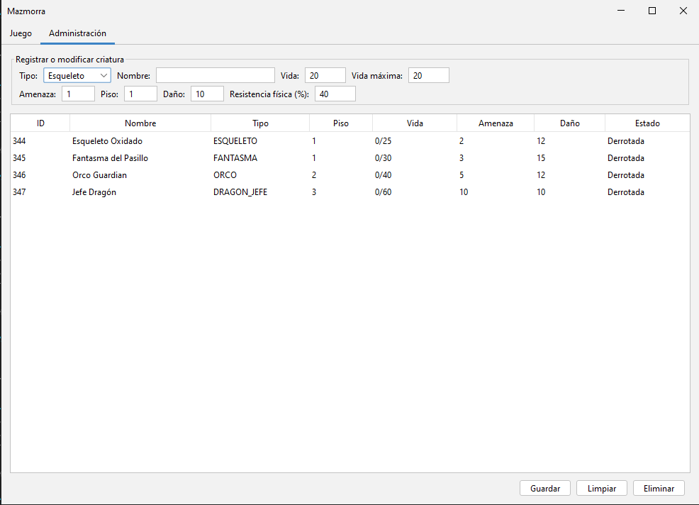
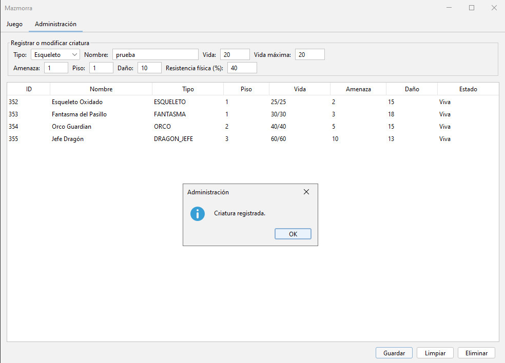
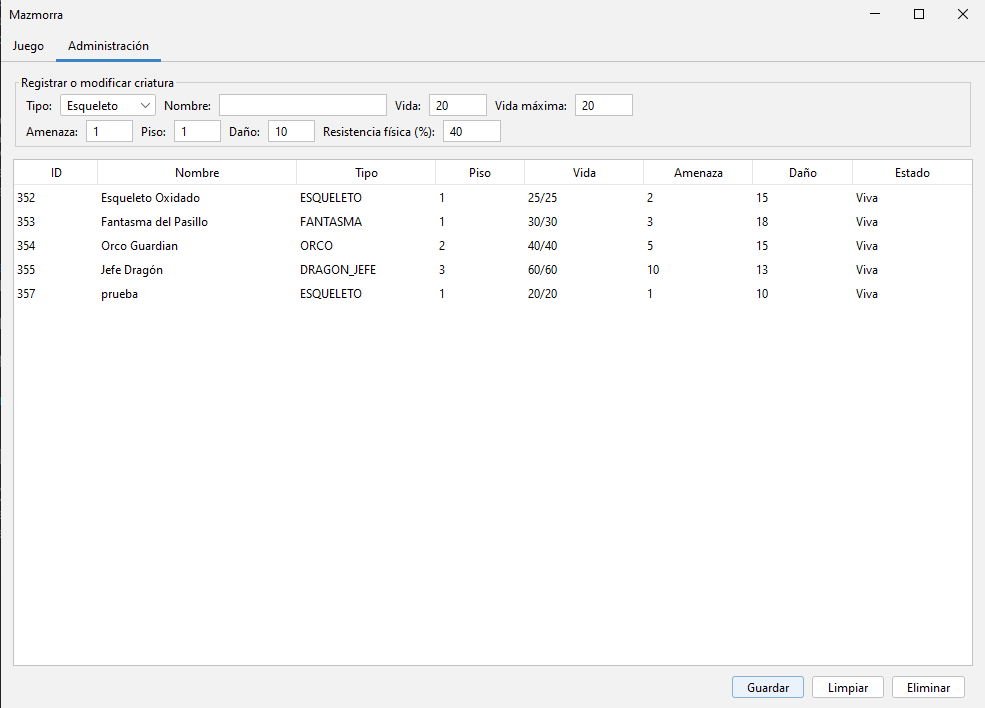

# Mazmorra
**Integrantes:** Santiago Molina
Juego de mazmorra por turnos con sprites, hecho en Java.

Dividido en capas: model → dao (interfaces + implementación MySQL) → service → ui (Swing).

**Tecnología:** Swing + FlatLaf, con sprites de pixel art dibujados por código.

## Requisitos

| Herramienta | Versión usada |
|---|---|
| JDK | 17 o superior (compila con `--release 17`) |
| Maven | 3.9 o superior |
| MySQL / MariaDB | 8.x / 10.4 |

Las dependencias de ejecución son `com.mysql:mysql-connector-j:8.3.0` y
`com.formdev:flatlaf:3.4.1`, que Maven descarga solo.

## Puesta en marcha

1. **Crear la base y el usuario** (una sola vez, como administrador de MySQL):

   ```sql
   CREATE DATABASE IF NOT EXISTS mazmorra
       CHARACTER SET utf8mb4 COLLATE utf8mb4_unicode_ci;
   CREATE USER IF NOT EXISTS 'mazmorra_app'@'localhost' IDENTIFIED BY 'CAMBIAR_ESTA_CLAVE';
   GRANT ALL PRIVILEGES ON mazmorra.* TO 'mazmorra_app'@'localhost';
   FLUSH PRIVILEGES;
   ```

   La contraseña es un ejemplo: elegí una propia y usá la misma en `db.properties`.

2. **Crear las tablas**:

   ```bash
   mysql -u mazmorra_app -p mazmorra < sql/schema.sql
   ```

   El script **elimina y vuelve a crear** las tablas `criatura` y `aventurero`,
   así que borra cualquier dato que ya existiera.

3. **Configurar la conexión**: copiar `db.properties.example` a `db.properties`
   y ajustar usuario y contraseña. Ese archivo está en `.gitignore`, así que
   nunca se sube al repositorio. También se puede sobrescribir con las variables
   de entorno `DB_URL`, `DB_USUARIO` y `DB_PASSWORD`, que tienen prioridad.

4. **Compilar y ejecutar**:

   ```bash
   mvn clean compile
   mvn exec:java
   ```

   Se abre la ventana del juego.

## Capturas

| Pantalla de inicio | Partida en curso |
|---|---|
|  |  |

| Combate | Error | 
|---|---|
|  |  |

| Panel De administracion | Criatura registrada exitosamente | Resultado de la tabla despues de registrar la criatura |
|---|---|---|
|  |  |  |

## Cómo se juega

El objetivo es bajar los tres pisos de la mazmorra y derrotar al Jefe Dragón.
Si la vida del aventurero llega a 0, la partida termina.

| Tecla | Acción |
|---|---|
| `W`, `A`, `S`, `D` | Moverse una casilla |
| `1` | Atacar físicamente al enemigo de al lado |
| `2` | Atacar con magia al enemigo de al lado |
| `P` | Tomar una poción |
| `H` | Huir del enemigo de al lado |
| `R` | Empezar una partida nueva |

El ataque es solo con `1` o `2`: caminar contra una criatura no ataca, solo
bloquea el paso. Para bajar de piso, caminá hacia la escalera cuando no queden
criaturas vivas.

La ventana tiene dos pestañas: **Juego** y **Administración**. En Administración
están la tabla de criaturas guardadas y el formulario para registrar, modificar
y eliminar; cada cambio se persiste en MySQL y la tabla se recarga sola. Si hay
una partida guardada, la pantalla de inicio ofrece `C` para continuar; `Enter`
empieza una nueva y pide confirmación antes de borrar los datos.

Cada tecla es un turno. Después de la acción del jugador, las criaturas vivas
del piso se mueven un casillero hacia el aventurero; si ya están al lado, lo
atacan. La criatura atacada responde en el acto si sobrevive. Solo una criatura
puede quedar pegada al aventurero a la vez: se elige un guardián al azar y los
demás se mantienen a cuatro casilleros hasta que ese guardián caiga. El guardián
no ataca el primer turno que asume; desde el siguiente, sí.

**Pisos.** En el primero esperan un esqueleto (resiste el daño físico) y un
fantasma (incorpóreo: recibe la mitad del daño físico). En el segundo, un orco
que resiste la mitad de la magia y contraataca. En el tercero, el Jefe Dragón:
cambia de fase a medida que pierde vida, escupe una lengua de fuego desde la
segunda fase y no permite huir.

**Oro y poción.** Cada criatura derrotada paga 5 de oro por nivel de amenaza.
La poción cura hasta 30 de vida; cuesta 20 si curás todo y menos si te falta
menos. El HUD muestra el cálculo exacto antes de usarla (por ejemplo,
`+12 vida por 8 de oro`, o `vida completa` si no hace falta). Curarse también
recibe el golpe del enemigo que tengas al lado, si hay uno, porque consume un
turno; nunca pegan dos a la vez.

La partida se guarda en MySQL: el aventurero y las criaturas se persisten a
través del DAO después de cada ataque, poción o huida. Al abrir el juego se leen
los datos existentes, y **Nueva partida** reinicia la base con el escenario
inicial.

## Diseño

### Jerarquía de criaturas

```
Danable (interfaz)
├── Criatura (abstracta)
│   ├── Esqueleto      → resistencia física (% de reducción)
│   ├── Fantasma       → incorpóreo (el daño físico se reduce a la mitad)
│   ├── Orco           → resiste la magia y contraataca si sobrevive
│   └── DragonJefe     → cambia de fase y no permite huir
└── Aventurero         → no es una criatura: implementa Danable por su cuenta
```

`Criatura` define el esqueleto del combate (`recibirDanio`, estado, piso) y
delega en cada subclase el cálculo del daño efectivo y el daño que devuelve al
atacar (`getDanioAtaque()`). `Aventurero` **no** hereda de `Criatura` porque no
comparte su comportamiento (no tiene piso de mazmorra, ni amenaza, ni tipo):
solo comparte el hecho de poder recibir daño, y eso es exactamente lo que
modela la interfaz.

### Uso polimórfico de la interfaz

```java
void resolverAtaque(Danable objetivo, int danio, TipoAtaque tipoAtaque)
```

La interfaz `Danable` es el parámetro de `resolverAtaque`: el servicio ataca sin
conocer la clase concreta, aplica el daño a una criatura o a un aventurero con
la misma llamada, y el objeto decide cómo reaccionar (`Fantasma` reduce el daño
físico, `Aventurero` solo descuenta vida).

El juego llama a `resolverTurno(Aventurero, Criatura, TipoAtaque)`, que resuelve
el daño con esa misma llamada polimórfica: el método privado `aplicarAtaque`
recibe un `Danable`. El `instanceof` que aparece después no elige cómo se aplica
el daño, sino qué DAO persiste el objeto actualizado, porque criaturas y
aventureros viven en tablas distintas.

El turno enemigo y la victoria también pasan por el Service:
`resolverAtaqueEnemigo` aplica y persiste el golpe de una criatura, y
`esVictoria` consulta si el Jefe Dragón del último piso ya cayó. La interfaz
solo anima y muestra el resultado.

### Reglas de negocio y excepciones

| Regla | Excepción |
|---|---|
| No se ataca a una criatura ya derrotada | `CriaturaYaDerrotadaException` |
| No se ataca a una criatura que quedó atrás al huir | `CriaturaEvadidaException` |
| El daño debe ser positivo | `DanioInvalidoException` |
| No se baja de piso con criaturas vivas | `CriaturasPendientesException` |
| No se puede huir del jefe final | `HuidaProhibidaException` |
| No se toma poción con la vida al máximo | `VidaCompletaException` |
| La poción se paga antes de curar | `OroInsuficienteException` |
| Un aventurero derrotado no puede actuar | `AventureroDerrotadoException` |
| El nombre (≤50) y el piso deben ser válidos | `DatosCriaturaInvalidosException` |
| No se repite el nombre en el piso ni hay dos Jefes Dragón | `CriaturaDuplicadaException` |

El modelo valida la forma de la criatura (nombre no vacío, vida coherente); el
Service valida las reglas de negocio (piso, nombre de hasta 50 caracteres,
Jefe Dragón único y en el piso final, nombres repetidos).

Todas heredan de `JuegoException`, y `PersistenciaException` envuelve los errores
de JDBC para que la capa de negocio no dependa de `SQLException`. La interfaz
muestra cada excepción en un diálogo, nunca por consola.

### Transacciones

El servicio no depende de JDBC: depende de la interfaz `db/Transaccion`, que le
entrega los DAO dentro de un `Trabajo`. `TransaccionMySQL` abre una sola
conexión, hace `commit` al terminar y `rollback` ante cualquier fallo. La
interfaz de los DAO no expone `Connection`: las operaciones comparten la conexión
que abrió la capa de persistencia.

### Persistencia

Una sola tabla `criatura` con una columna `Tipo`, la columna común `DanioAtaque`
y las columnas específicas de cada subclase en `NULL` cuando no aplican
(`ResistenciaFisica`, `EsIncorporeo`, `ResistenciaMagica`, fase y aliento del
jefe). `Evadida` marca a las criaturas que quedaron atrás al huir y
`RecompensaPagada` impide cobrar dos veces la misma recompensa. El DAO
reconstruye la subclase correcta al leer (`switch` sobre el enum
`TipoCriatura`), y así el modelo queda polimórfico aunque la base sea relacional
y plana.

## Estructura del proyecto

```
src/main/java/com/mazmorra/
├── Main.java             punto de entrada: tema FlatLaf y ventana del juego
├── Reglas.java           constantes con los valores del juego
├── ui/                   VentanaJuego, PanelJuego, PanelAdministracion,
│                         ModeloTablaCriaturas, Sprites, DialogosError
├── consola/              MainConsola, JuegoConsola, DemoGuionada (referencia)
├── db/                   Conexion, Transaccion
├── db/impl/              TransaccionMySQL
├── model/        Danable, TipoAtaque, TipoCriatura, Criatura, Esqueleto,
│                 Fantasma, Orco, DragonJefe, Aventurero
├── dao/          CriaturaDAO, AventureroDAO
├── dao/impl/     CriaturaDAOMySQL, AventureroDAOMySQL
├── service/      JuegoService, Escenario, ResultadoPocion
├── service/impl/ JuegoServiceImpl
└── exception/    JuegoException, PersistenciaException y las 10 reglas
docs/                         capturas de pantalla
sql/schema.sql
db.properties.example
```
