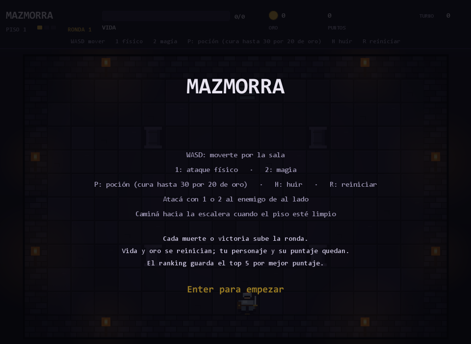
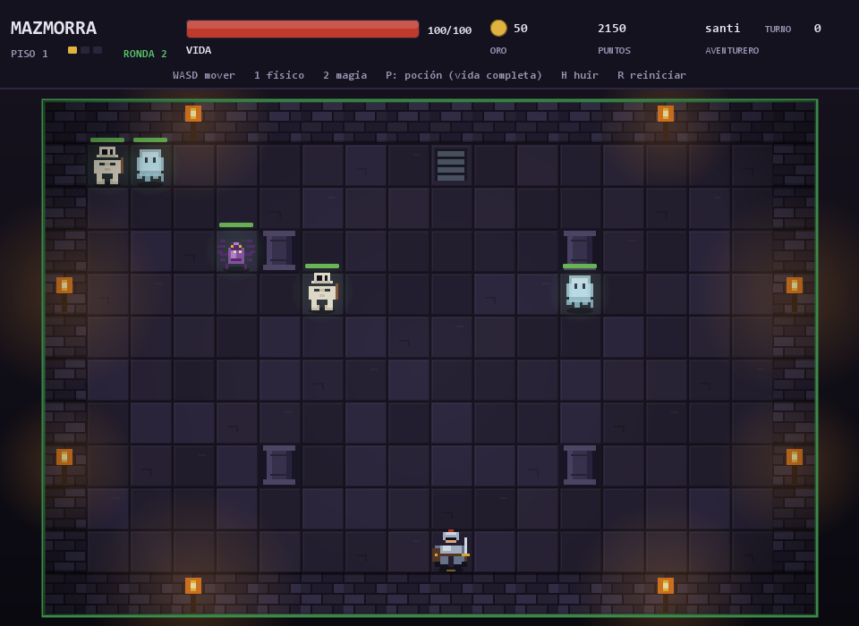
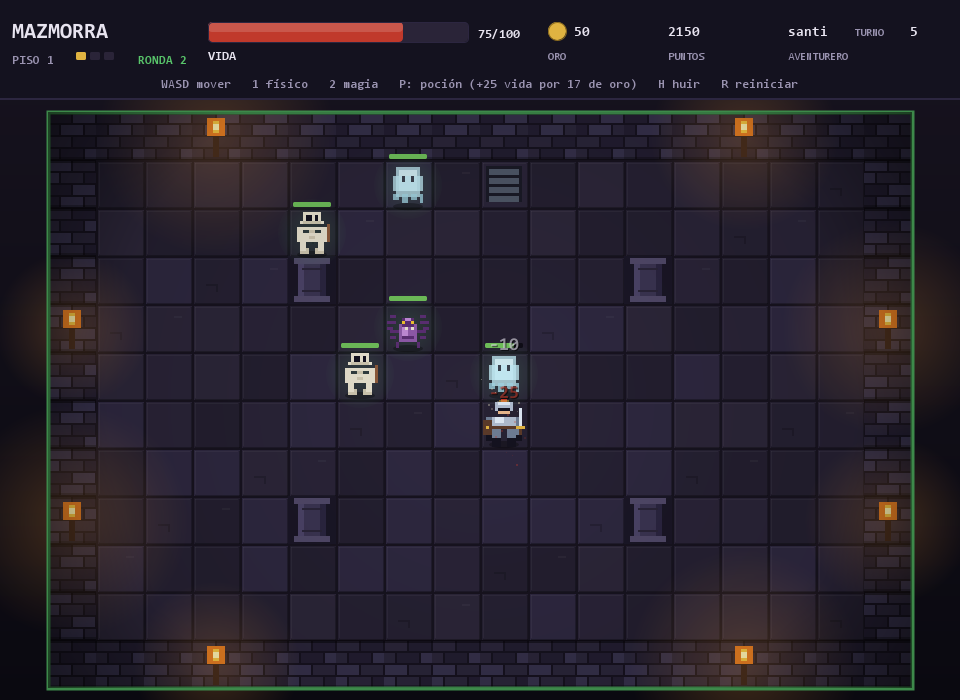
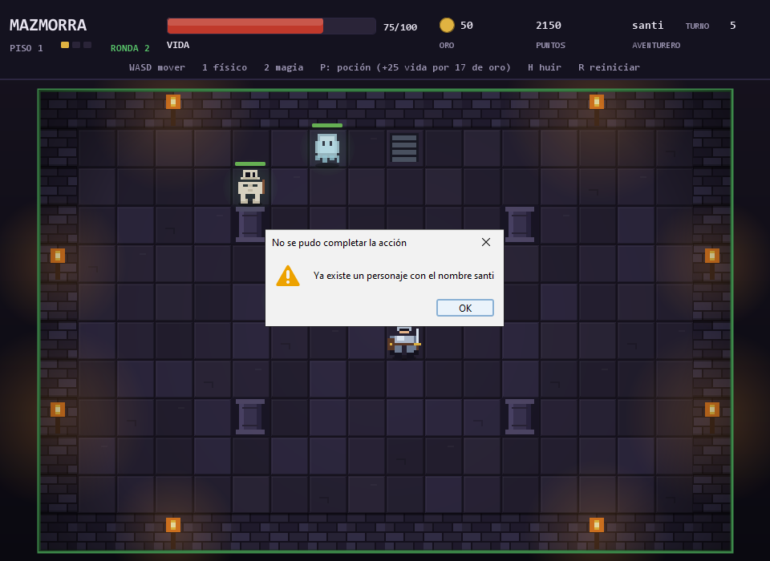
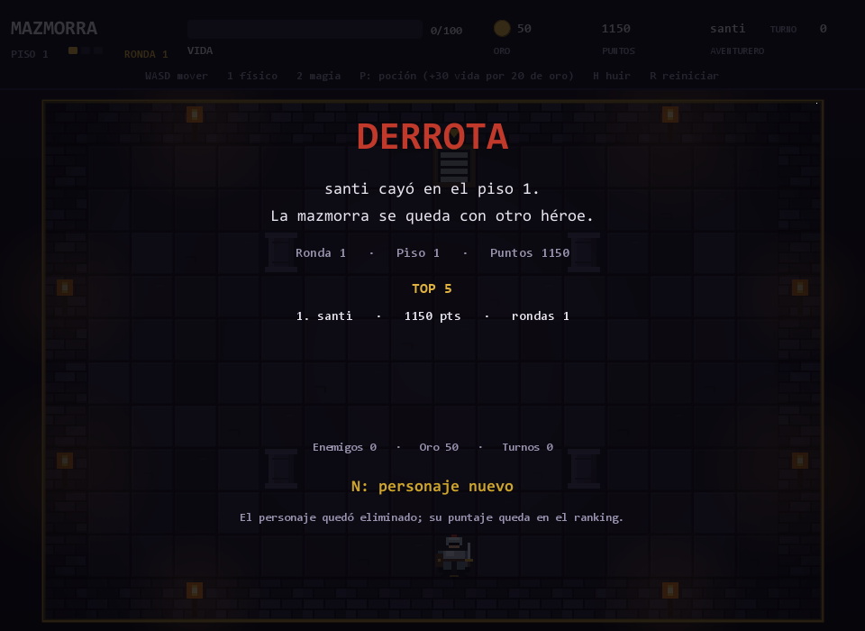

# Mazmorra
**Integrantes:** Santiago Molina
Juego de mazmorra por turnos con sprites, hecho en Java.

Dividido en capas: model → dao (interfaces + implementación MySQL) → service → ui (Swing).
Cada personaje tiene identidad propia, ranking y una partida que avanza en rondas
cada vez más difíciles mientras gane.

**Tecnología:** Swing + FlatLaf, con sprites de pixel art dibujados por código.

**Prompts:** están en el archivo `prompts.md`; son todos los prompts que usé para hacer el código.

## Requisitos

| Herramienta | Versión usada |
|---|---|
| JDK | 17 o superior (compila con `--release 17`) |
| Maven | 3.9 o superior |
| MySQL / MariaDB | 8.x / 10.4 |

Las dependencias de ejecución son `com.mysql:mysql-connector-j:8.3.0` y
`com.formdev:flatlaf:3.4.1`, que Maven descarga solo.

## Puesta en marcha

1. **Crear la base y el usuario** (una sola vez, como usuario con permisos de MySQL):

   ```sql
   CREATE DATABASE IF NOT EXISTS mazmorra
       CHARACTER SET utf8mb4 COLLATE utf8mb4_unicode_ci;
   CREATE USER IF NOT EXISTS 'mazmorra_app'@'localhost' IDENTIFIED BY 'CAMBIAR_ESTA_CLAVE';
   GRANT ALL PRIVILEGES ON mazmorra.* TO 'mazmorra_app'@'localhost';
   FLUSH PRIVILEGES;
   ```

   La contraseña es un ejemplo: elegí una propia y usá la misma en `db.properties`.

2. **Crear las tablas**:

   ```bash
   mysql -u mazmorra_app -p mazmorra < sql/schema.sql
   ```

   El script **elimina y vuelve a crear** todas las tablas, así que borra cualquier
   dato que ya existiera.

3. **Configurar la conexión**: copiar `db.properties.example` a `db.properties`
   y ajustar usuario y contraseña. Ese archivo está en `.gitignore`, así que
   nunca se sube al repositorio. También se puede sobrescribir con las variables
   de entorno `DB_URL`, `DB_USUARIO` y `DB_PASSWORD`, que tienen prioridad.

4. **Compilar y ejecutar**:

   ```bash
   mvn clean compile
   mvn exec:java
   ```

   Se abre la ventana del juego.

## Capturas

| Pantalla de inicio | Partida en curso |
|---|---|
|  |  |

| Combate | Error |
|---|---|
|  |  |

| Ranking final |
|---|
|  |

## Cómo se juega

El objetivo es sobrevivir la mayor cantidad de rondas posible. Si el aventurero
derrota al Jefe Dragón, la partida termina en victoria y puede continuar a la
siguiente ronda con la vida y el oro reiniciados, conservando el personaje y su
puntaje. Si muere, la partida termina en derrota: el personaje queda eliminado y
no se puede continuar a la siguiente ronda; hay que empezar con otro personaje.

| Tecla | Acción |
|---|---|
| `W`, `A`, `S`, `D` | Moverse una casilla |
| `1` | Atacar físicamente al enemigo de al lado |
| `2` | Atacar con magia al enemigo de al lado |
| `P` | Tomar una poción |
| `H` | Huir del enemigo de al lado (cuesta 10 de oro y recibís su golpe) |
| `C` | Continuar una partida viva o una victoria pendiente desde la pantalla de inicio |
| `Enter` | Empezar con un personaje nuevo desde la pantalla de inicio |
| `R` | En partida, empezar con un personaje nuevo; después de una victoria, pasar a la siguiente ronda |
| `N` | Después de una derrota o una victoria, empezar con un personaje nuevo |

El ataque es solo con `1` o `2`: caminar contra una criatura no ataca, solo
bloquea el paso. Para bajar de piso, caminá hacia la escalera cuando no queden
criaturas vivas. La ventana tiene una sola pantalla de juego.

Cada personaje se registra con un nombre único (sin distinguir mayúsculas,
tildes ni espacios finales). Si el nombre ya existe, el juego muestra el error y
no crea un duplicado. Al empezar una partida nueva se reemplaza la partida
guardada, pero el historial y el ranking de los personajes anteriores se conserva.

Cada ataque, huida o movimiento es un turno. Después de la acción del jugador, las
criaturas vivas del piso se mueven un casillero hacia el aventurero; si ya están al
lado, lo atacan. La criatura atacada responde en el acto si sobrevive. Solo una
criatura puede quedar pegada al aventurero a la vez: se elige un guardián al azar y
los demás se mantienen a cuatro casilleros hasta que ese guardián caiga. El guardián
no ataca el primer turno que asume; desde el siguiente, sí. La poción también
consume el turno, pero solo responde el enemigo que tenés al lado; si no hay
ninguno, las demás criaturas no se mueven. Huir cuesta 10 de oro, la criatura te
golpea al escapar y queda atrás; después actúan las demás criaturas del piso.

### Rondas, dificultad y ranking

- La primera ronda usa un factor de **1.15** sobre la vida y el daño base.
- Desde la ronda 2, cada ronda suma **+35% de vida**, **+25% de daño** y
  **+2 enemigos por piso**.
- La **Araña** aparece desde la ronda 2 y el **Gólem** desde la 3. El Gólem
  resiste el 40% del daño físico.
- El puntaje de una partida se calcula así:

  ```text
  puntos = ronda × 1000 + piso × 100 + oro + enemigos derrotados × 10
  ```

- El ranking muestra el **top 5** por mejor puntaje; cada personaje conserva su
  mejor partida, la cantidad de partidas y la ronda máxima alcanzada.
- Al ganar o morir se guarda la partida en `partida`, se actualiza el personaje en
  `personaje` y se muestra el ranking en la pantalla final.
- Solo la victoria permite seguir a la siguiente ronda. La derrota cierra la
  partida: el personaje no se puede continuar.

**Pisos y criaturas.** En el primero esperan un esqueleto (resiste el daño físico),
un fantasma (incorpóreo: recibe la mitad del daño físico) y, desde la ronda 2,
arañas. En el segundo, un orco que resiste la mitad de la magia, arañas y, desde
la ronda 3, gólems. En el tercero, el Jefe Dragón: cambia de fase a medida que
pierde vida, escupe una lengua de fuego desde la segunda fase y no permite huir.
Las rondas avanzadas agregan copias de los enemigos de cada piso. Toda criatura
viva contraataca si sobrevive al ataque; el Orco no es la excepción.

**Oro y poción.** Cada criatura derrotada paga 5 de oro por nivel de amenaza.
La poción cura hasta 30 de vida; cuesta 20 si curás todo y menos si te falta
menos. El HUD muestra el cálculo exacto antes de usarla (por ejemplo,
`+12 vida por 8 de oro`, o `vida completa` si no hace falta). Curarse también
recibe el golpe del enemigo que tengas al lado, si hay uno, porque consume un
turno; nunca pegan dos a la vez.

La partida se guarda en MySQL: el aventurero y las criaturas se persisten a
través del DAO después de cada ataque, poción o huida. Al abrir el juego se leen
los datos existentes; `C` continúa una partida viva o una victoria pendiente, y
`Enter`/`R` empiezan con un personaje nuevo. Al continuar se recuperan la vida,
el oro, el piso y las criaturas, pero las posiciones del aventurero y de las
criaturas se recalculan desde el inicio del piso.

## Diseño

### Jerarquía de criaturas

```
Danable (interfaz)
├── Criatura (abstracta)
│   ├── Esqueleto      → resistencia física (% de reducción)
│   ├── Fantasma       → incorpóreo (el daño físico se reduce a la mitad)
│   ├── Orco           → resiste la magia
│   ├── DragonJefe     → cambia de fase y no permite huir
│   ├── Arana          → sin resistencias; aparece desde la ronda 2
│   └── Golem          → resistencia física del 40%; aparece desde la ronda 3
└── Aventurero         → no es una criatura: implementa Danable por su cuenta
```

`Criatura` define el esqueleto del combate (`recibirDanio`, estado, piso) y
delega en cada subclase el cálculo del daño efectivo y el daño que devuelve al
atacar (`getDanioAtaque()`). `Aventurero` **no** hereda de `Criatura` porque no
comparte su comportamiento (no tiene piso de mazmorra, ni amenaza, ni tipo):
solo comparte el hecho de poder recibir daño, y eso es exactamente lo que
modela la interfaz.

`Personaje` y `Partida` son las piezas nuevas del registro: no participan del
combate, sino que acumulan identidad, mejor puntaje e historial entre
rondas.

### Uso polimórfico de la interfaz

```java
private boolean aplicarAtaque(Danable objetivo, int danio, TipoAtaque tipoAtaque, ...)
```

La interfaz `Danable` es el parámetro de `aplicarAtaque`: el servicio ataca sin
conocer la clase concreta, aplica el daño a una criatura o a un aventurero con
la misma llamada, y el objeto decide cómo reaccionar (`Fantasma` reduce el daño
físico, `Aventurero` solo descuenta vida).

El juego llama a `resolverTurno(Aventurero, Criatura, TipoAtaque)`, que resuelve
el daño con esa misma llamada polimórfica: el método privado `aplicarAtaque`
recibe un `Danable`. `Danable` también expone `recibirDanio(int, TipoAtaque)`: las
criaturas lo usan para aplicar sus resistencias y el aventurero hereda la versión
base. Por eso el `instanceof` de `aplicarAtaque` solo decide qué DAO persiste; el
daño se resuelve por la interfaz.

El turno enemigo y la victoria también pasan por el Service:
`resolverAtaqueEnemigo` aplica y persiste el golpe de una criatura, y
`esVictoria` consulta si el Jefe Dragón del último piso ya cayó. La interfaz
solo anima y muestra el resultado.

### Reglas de negocio y excepciones

| Regla | Excepción |
|---|---|
| No se ataca a una criatura ya derrotada | `CriaturaYaDerrotadaException` |
| No se ataca a una criatura que quedó atrás al huir | `CriaturaEvadidaException` |
| El daño debe ser positivo | `DanioInvalidoException` |
| No se baja de piso con criaturas vivas | `CriaturasPendientesException` |
| No se puede huir del jefe final | `HuidaProhibidaException` |
| No se toma poción con la vida al máximo | `VidaCompletaException` |
| La poción se paga antes de curar | `OroInsuficienteException` |
| Un aventurero derrotado no puede actuar | `AventureroDerrotadoException` |
| No se baja del último piso | `PisoFinalException` |
| No se repite el nombre de un personaje | `PersonajeDuplicadoException` |

El modelo valida la forma de la criatura (nombre no vacío, vida coherente) y el
Service valida las reglas de combate, piso, poción y huida.

Todas heredan de `JuegoException`, y `PersistenciaException` envuelve los errores
de JDBC para que la capa de negocio no dependa de `SQLException`. La interfaz
muestra cada excepción en un diálogo.

### Transacciones

El servicio no depende de JDBC: depende de la interfaz `db/Transaccion`, que le
entrega los DAO dentro de un `Trabajo`. `TransaccionMySQL` abre una sola
conexión, hace `commit` al terminar y `rollback` ante cualquier fallo. La
interfaz de los DAO no expone `Connection`: las operaciones comparten la conexión
que abrió la capa de persistencia. El trabajo recibe los cuatro DAO:
`CriaturaDAO`, `AventureroDAO`, `PersonajeDAO` y `PartidaDAO`.

### Persistencia

Una sola tabla `criatura` con una columna `Tipo`, la columna común `DanioAtaque`
y las columnas específicas de cada subclase en `NULL` cuando no aplican
(`ResistenciaFisica`, `EsIncorporeo`, `ResistenciaMagica`, fase y aliento del
jefe). `Evadida` marca a las criaturas que quedaron atrás al huir y
`RecompensaPagada` impide cobrar dos veces la misma recompensa.

La Araña y el Gólem se guardan así:
`Arana` usa `Tipo = ARANA` y `Golem` usa `Tipo = GOLEM`. El DAO reconstruye la
subclase correcta al leer (`switch` sobre el enum `TipoCriatura`), y así el modelo
queda polimórfico aunque la base sea relacional y plana.

`personaje` guarda la identidad y los acumulados (`MejorPuntaje`, `Rondas`,
`Partidas`), `partida` guarda cada resultado con ronda, piso, oro, enemigos y
puntos, y `aventurero` incorpora `PersonajeID`, `Ronda` y
`EnemigosDerrotados` para la partida en curso. `aventurero.PersonajeID` y
`partida.PersonajeID` referencian `personaje.ID` con clave foránea.

## Estructura del proyecto

```
src/main/java/com/mazmorra/
├── Main.java             punto de entrada: tema FlatLaf y ventana del juego
├── Reglas.java           constantes con los valores del juego
├── ui/                   VentanaJuego, PanelJuego, Sprites, DialogosError
├── db/                   Conexion, Transaccion
├── db/impl/              TransaccionMySQL
├── model/        Danable, TipoAtaque, TipoCriatura, Criatura, Esqueleto,
│                 Fantasma, Orco, Arana, Golem, DragonJefe, Aventurero,
│                 Personaje, Partida
├── dao/          CriaturaDAO, AventureroDAO, PersonajeDAO, PartidaDAO
├── dao/impl/     CriaturaDAOMySQL, AventureroDAOMySQL, PersonajeDAOMySQL,
│                 PartidaDAOMySQL
├── service/      JuegoService, Escenario, ResultadoPocion, InicioPartida
├── service/impl/ JuegoServiceImpl
└── exception/    JuegoException, PersistenciaException y las reglas de negocio
docs/                         capturas de pantalla
sql/schema.sql                esquema completo (destructivo)
db.properties.example
```
